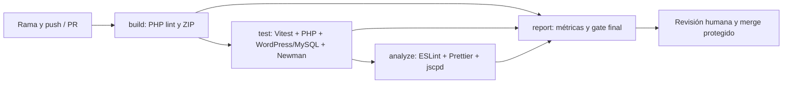

# Manual técnico

## Arquitectura



El plugin registra `/agenda/v1/contactos` y rutas de autenticación. WordPress gestiona usuarios, cookies, nonces y REST. Cada consulta o modificación de contacto se restringe al ID del usuario autenticado. El frontend agrega `X-WP-Nonce` y conserva cookies same-origin. La base tiene una tabla propia con prefijo WordPress; los usuarios están en las tablas estándar.

## Rutas del repositorio

| Ruta | Función |
|---|---|
| desa_Agenda_Proyecto2/agenda-contactos | Fuente de la aplicación reutilizada |
| desa_Agenda_Proyecto2/tests/php-regression.php | 77 comprobaciones con dobles |
| tests/frontend | Casos jsdom y Vitest |
| tests/php/coverage.php | Instrumentación Xdebug, Clover y gate |
| tests/integration/wordpress.php | REST real y MySQL; limpia usuarios creados |
| tests/postman | Colección exportable a Postman |
| scripts/setup-wp.php | Instalación aislada, activación y página |
| scripts/build.cjs | Sintaxis PHP y ZIP instalable |
| scripts/report.cjs | Resumen HTML y JSON |
| .github/workflows/ci.yml | Cuatro jobs y gate final |

## Reproducción en Windows / Laragon

Requisitos: Node 22+, PHP 8.3 con mysqli, MySQL 8.4 y Xdebug para cobertura. Ejecutar desde la raíz del repositorio.

```powershell
$env:PHP_BIN='C:/laragon/bin/php/php-8.3.30-Win32-vs16-x64/php.exe'
npm ci
npm run build
npm test
npm run analyze
```

Para Xdebug, habilitar la extensión compatible con la compilación de PHP o pasar `-d zend_extension=RUTA_ABSOLUTA_DLL -d xdebug.mode=coverage` al ejecutar `tests/php/coverage.php`. `REQUIRE_PHP_COVERAGE=1` obliga la instrumentación. El script filtra las clases productivas; no mide WordPress ni dobles.

Integración aislada:

1. Descargar WordPress 6.8.3 y extraerlo en `.runtime/wordpress`.
2. Crear una instancia MySQL temporal con datos en `.runtime/mysql`, escuchar solo en 127.0.0.1:13307 y crear la base `agenda_sqa`.
3. Copiar `desa_Agenda_Proyecto2/agenda-contactos` a `.runtime/wordpress/wp-content/plugins/`.
4. Definir `SQA_DB_HOST=127.0.0.1:13307` y `SQA_DB_PASSWORD` si aplica. El usuario esperado del entorno desechable es root. CI usa un servicio MySQL efímero con contraseña de prueba.
5. Ejecutar `php scripts/setup-wp.php`, luego `php tests/integration/wordpress.php`.
6. Iniciar `php -S 127.0.0.1:8080 -t .runtime/wordpress` y ejecutar `npm run test:e2e`.
7. Ejecutar `npm run report`. Abrir `reports/dashboard.html`.

No reutilizar la base de producción. La colección deja usuarios ficticios en la instalación temporal. El script de integración elimina sus propios usuarios en finally. Para repetir la integración puede usarse la misma base desechable; nombres aleatorios evitan colisiones.

## CI y mantenimiento

`build` ejecuta php -l en todos los PHP del plugin y crea ZIP. `test` exige cobertura, levanta MySQL, instala WordPress, verifica integración y usa Newman. `analyze` bloquea errores y duplicación excesiva. `report` usa always() para intentar publicar evidencia aun tras un fallo y exige que los tres jobs previos terminen en success. Los pasos de descarga tolerantes no convierten un test fallido en aprobado: el gate final revisa needs.*.result.

Cada corrección debe añadir una regresión relacionada. Para actualizar dependencias modificar package.json/lock, ejecutar suites, revisar deprecaciones y guardar métricas. Nunca reducir umbrales para ocultar un fallo. Los errores iniciales no deben silenciarse con continue-on-error en build/test/analyze.

## SonarQube Cloud opcional

La alternativa implementada es ESLint + jscpd y un dashboard local. Para incorporar Sonar: importar el repo en SonarQube Cloud, asignar organización, desactivar análisis automático si se analiza desde CI, crear `SONAR_TOKEN` en Secrets, ejecutar scanner después de descargar LCOV/Clover y requerir su gate. El archivo de propiedades ya espera ambos reportes y usa `sonar.qualitygate.wait=true`. No subir el token. Sin este paso no existe un panel Sonar real ni métricas de bugs/code smells de esa herramienta.

## Limitaciones

PHP lint verifica sintaxis; no es análisis semántico ni auditoría de seguridad. ESLint analiza JavaScript. jscpd calcula clones, no bugs. El dashboard muestra esas métricas reales y declara las no medidas. La versión WordPress fijada permite reproducibilidad; producción debe planificar actualizaciones y repetir regresiones.

Referencias: [GitHub status checks](https://docs.github.com/en/pull-requests/reference/status-checks), [ramas protegidas](https://docs.github.com/en/repositories/configuring-branches-and-merges-in-your-repository/managing-protected-branches/about-protected-branches), [cobertura Sonar](https://docs.sonarsource.com/sonarqube-cloud/analyzing-source-code/test-coverage/overview), [WordPress REST API](https://developer.wordpress.org/rest-api/), [Postman Newman](https://learning.postman.com/docs/collections/using-newman-cli/command-line-integration-with-newman/).
